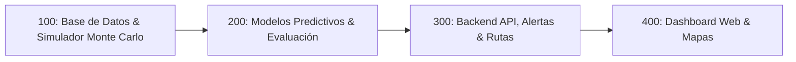

# Plan General del Software SICRA

> **Proyecto:** Sistema Inteligente para el Control y Recolección de Aceite Vegetal Usado (SICRA)  
> **Alcance:** Suite de Software — Base de Datos, Servidor Backend, Modelos Matemáticos/Predictivos y Plataforma Web  
> **Nota de Alcance:** El firmware de los dispositivos microcontroladores (ESP32) se gestiona de manera externa. El sistema de software interactúa a través de contratos de API REST bien definidos.  
> **Versión:** 2.0.0

---

## 1. Visión y Propósito General

El software de **SICRA** tiene como finalidad optimizar de forma predictiva la recolección de aceite de cocina usado (ACU) en establecimientos comerciales (frituras, cafeterías y pica-pollos) para evitar la contaminación de fuentes hídricas y cumplir con la legislación dominicana (Ley 225-20).

El sistema sustituye la logística fija y reactiva tradicional por un ecosistema impulsado por datos que:
1. **Ingesta telemetría** periódica o por lotes (incluso tras caídas de red) enviada por recipientes inteligentes.
2. **Predice flujos diarios** de aceite mediante regresión lineal regularizada, Modelos Lineales Generalizados (GLM) y modelos ensamblados, garantizando no negatividad y superando al modelo estacional de referencia (Requisito R-04).
3. **Dispara alertas tempranas** al alcanzar aproximadamente el 80% de capacidad (Requisito R-05).
4. **Calcula rutas dinámicas óptimas** para los camiones recolectores de empresas autorizadas (Reoil, Mevosa).
5. **Ofrece paneles web visuales** tanto para la gestión logística de la flota como para el autocontrol del encargado del negocio gastronómico.

---

## 2. Estructura de Etapas del Software (Múltiplos de 100)

El desarrollo del software se organiza en cuatro etapas consecutivas y modulares:

| Etapa | Nombre | Enfoque Central | Enlace a la Especificación |
| :---: | :--- | :--- | :--- |
| **`100`** | **`100_etapa_db_y_simulacion_de_datos`** | Esquema relacional de base de datos y simulador probabilístico Monte Carlo de telemetría (20k–100k registros) con flag `es_sintetico`. | [Ver spec.md](file:///home/thegxnster/sicra/__specs__/100_etapa_db_y_simulacion_de_datos/spec.md) |
| **`200`** | **`200_etapa_modelos_predictivos_ml`** | Motor de ML: Regresión con GLM (Gamma/Poisson), interacciones, regularización Ridge/Lasso, baselines (*seasonal naive* y tasa de llenado), validación cronológica y Regla de Oro (MAE). | [Ver spec.md](file:///home/thegxnster/sicra/__specs__/200_etapa_modelos_predictivos_ml/spec.md) |
| **`300`** | **`300_etapa_backend_api_y_rutas`** | Servidor FastAPI: Endpoint de ingesta IoT (soporte offline/lotes), detección de vaciados, motor de alertas al 80%, algoritmo heurístico de optimización de rutas (TSP/2-opt) y seguridad RBAC. | [Ver spec.md](file:///home/thegxnster/sicra/__specs__/300_etapa_backend_api_y_rutas/spec.md) |
| **`400`** | **`400_etapa_frontend_dashboard_web`** | Plataforma web reactiva: Mapa interactivo con semáforo de llenado para la recolectora, panel simplificado con medidor para el dueño del negocio y monitor de desempeño del modelo ML. | [Ver spec.md](file:///home/thegxnster/sicra/__specs__/400_etapa_frontend_dashboard_web/spec.md) |

---

## 3. Resumen Ejecutivo de cada Etapa



### [100_etapa_db_y_simulacion_de_datos](file:///home/thegxnster/sicra/__specs__/100_etapa_db_y_simulacion_de_datos/spec.md)
* **Objetivo:** Establecer la capa de persistencia y el generador sintético para desacoplar el desarrollo del software del despliegue físico de hardware.
* **Componentes clave:**
  * Modelado relacional (`negocios`, `recipientes`, `telemetrias`, `predicciones`, `alertas`, `rutas_recoleccion`).
  * Generador Monte Carlo en Python basado en distribuciones Gamma y Poisson para simular consumos realistas según perfiles de local (frituras, pica-pollos, cafeterías) con variación semanal y vaciados.
* **Entregable:** Esquema SQL / SQLAlchemy y script generador con semilla reproducible (`numpy.random`).

### [200_etapa_modelos_predictivos_ml](file:///home/thegxnster/sicra/__specs__/200_etapa_modelos_predictivos_ml/spec.md)
* **Objetivo:** Implementar y validar los algoritmos matemáticos y estadísticos definidos en la guía de estudio predictivo.
* **Componentes clave:**
  * **Opción 1:** Regresión lineal múltiple con regularización (Ridge/Lasso) y Modelos Lineales Generalizados (GLM con familia Gamma/Poisson) para garantizar que las predicciones nunca sean negativas.
  * **Opción 2:** Modelos base de referencia obligatorios (*seasonal naive* y cálculo de tasa de llenado local $\Delta V/\Delta t$).
  * **Opción 4:** Ensamble no lineal (Random Forest / Gradient Boosting) preentrenado con datos sintéticos y ajustado con datos reales.
  * **Validación:** Partición cronológica estricta (`TimeSeriesSplit`) y verificación de la Regla de Oro: $\text{MAE}_{\text{modelo}} < \text{MAE}_{\text{referencia}}$.
* **Entregable:** Módulos de entrenamiento, inferencia y validación comparativa en Python.

### [300_etapa_backend_api_y_rutas](file:///home/thegxnster/sicra/__specs__/300_etapa_backend_api_y_rutas/spec.md)
* **Objetivo:** Desarrollar el servidor de aplicaciones para la ingesta de telemetría IoT, emisión automática de alertas y cálculo de rutas dinámicas.
* **Componentes clave:**
  * API REST en FastAPI con endpoint `POST /api/v1/telemetry/ingest` que soporta telemetría en tiempo real o en lotes diferidos (ante caídas de conexión Wi-Fi del nodo).
  * Lógica de detección de eventos de vaciado (reducción brusca de peso).
  * Servicio de alerta automática cuando un contenedor alcanza o supera el 80% de su capacidad nominal.
  * Algoritmo de ruteo vehicular (TSP con heurística 2-opt) para secuenciar paradas óptimas del camión recolector.
  * Control de acceso basado en roles (RBAC: Admin, Recolectora, Negocio) y cifrado TLS (ISO 27001).
* **Entregable:** Servidor backend FastAPI estructurado, documentado con OpenAPI/Swagger y suite de pruebas de endpoints.

### [400_etapa_frontend_dashboard_web](file:///home/thegxnster/sicra/__specs__/400_etapa_frontend_dashboard_web/spec.md)
* **Objetivo:** Crear la interfaz web interactiva y responsiva para empresas recolectoras, generadores de aceite y administradores del sistema.
* **Componentes clave:**
  * **Dashboard de la Recolectora:** Mapa interactivo con pines semafóricos (#1b2a66, #5D8054, #998937, #f2f2f2), listado de alertas y trazo visual de la hoja de ruta del día.
  * **Portal del Negocio Gastronómico:** Medidor circular simple de volumen, estado amigable y medidor de impacto ecológico (litros de agua protegidos).
  * **Monitor Analítico de ML:** Gráficas comparativas de telemetría real vs. predicción y seguimiento en vivo del cumplimiento de error (MAE).
* **Entregable:** Aplicación web frontend moderna conectada a las APIs del backend.

---

## 4. Estructura de Archivos del Repositorio

```text
sicra/
├── .gitignore
├── plan.md                                          <-- Plan general del software
├── docs/                                            <-- Documentos de contexto y estudio
│   ├── Grupo_aceite_planificación.pdf
│   └── Guía de estudio modelo predictivo para el sistema de control y recolección de aceite.pdf
└── __specs__/                                       <-- Especificaciones por etapa (múltiplos de 100)
    ├── 100_etapa_db_y_simulacion_de_datos/
    │   └── spec.md
    ├── 200_etapa_modelos_predictivos_ml/
    │   └── spec.md
    ├── 300_etapa_backend_api_y_rutas/
    │   └── spec.md
    └── 400_etapa_frontend_dashboard_web/
        └── spec.md
```
