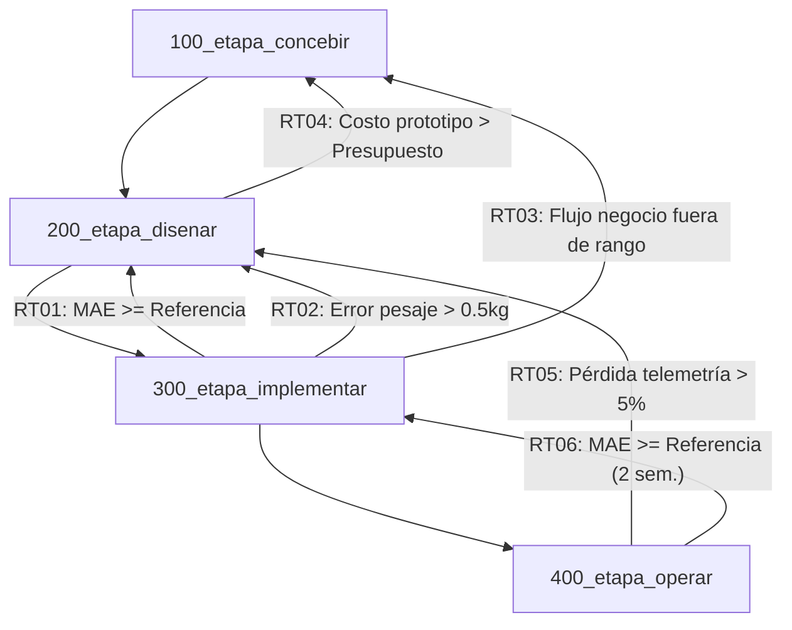

# Plan General del Proyecto SICRA

> **Proyecto:** Sistema Inteligente para el Control y Recolección de Aceite Vegetal Usado (SICRA)  
> **Marco Metodológico:** CDIO (Concebir – Diseñar – Implementar – Operar)  
> **Institución:** Universidad Central del Este (UCE) — Proyecto Integrador I  
> **Versión:** 1.0.0

---

## 1. Resumen Ejecutivo y Objetivo General

**SICRA** es una solución integral orientada a mitigar el vertido informal e inadecuado de aceite de cocina usado (ACU) en establecimientos gastronómicos dominicanos (frituras, cafeterías y pica-pollos). El sistema combina:

1. **Hardware IoT:** Recipientes inteligentes construidos en Polietileno de Alta Densidad (PEAD) equipados con celdas de carga, acondicionador de señal HX711 y microcontrolador ESP32 con gestión ultra-eficiente de energía ($\ge 30$ días de autonomía) y memoria local tolerante a cortes de red Wi-Fi.
2. **Modelo Predictivo:** Estimador de flujo diario de generación en Python basado en regresión lineal múltiple con regularización y GLM, superando a modelos de referencia basados en promedios estacionales.
3. **Plataforma Web y Logística Dinámica:** Panel de control que centraliza la telemetría, dispara alertas tempranas al alcanzar aproximadamente el 80% de la capacidad y genera rutas dinámicas de recolección para optimizar los traslados de las empresas recolectoras autorizadas (bajo la Ley 225-20 y Ley 64-00).

---

## 2. Estructura de Etapas del Proyecto (Ciclo CDIO)

El plan maestro se articula en cuatro grandes etapas numeradas en múltiplos de 100:

| Código de Etapa | Fase CDIO | Enfoque Principal | Documento de Especificación |
| :--- | :--- | :--- | :--- |
| **`100_etapa_concebir`** | Concebir (C-1.0) | Delimitación de demanda, 5 negocios candidatos, formalización de requisitos R-01 a R-10, matriz de alternativas técnicas y marco legal. | [Ver especificación](file:///home/thegxnster/sicra/__specs__/100_etapa_concebir/spec.md) |
| **`200_etapa_disenar`** | Diseñar (D-2.0) | Ingeniería de detalle: recipiente PEAD, esquemático electrónico, firmware ESP32 resiliente, formulación del modelo predictivo y arquitectura web/seguridad. | [Ver especificación](file:///home/thegxnster/sicra/__specs__/200_etapa_disenar/spec.md) |
| **`300_etapa_implementar`** | Implementar (I-3.0) | Ensamble del prototipo físico, recolección manual de $\ge 70$ registros en CSV, entrenamiento del modelo en Python, calibración metrológica y pruebas de estrés. | [Ver especificación](file:///home/thegxnster/sicra/__specs__/300_etapa_implementar/spec.md) |
| **`400_etapa_operar`** | Operar (O-4.0) | Puesta en servicio en local piloto, alertas web al 80%, ruteo dinámico, reentrenamiento semanal (MLOps), mantenimiento preventivo y gestión de residuos. | [Ver especificación](file:///home/thegxnster/sicra/__specs__/400_etapa_operar/spec.md) |

---

## 3. Detalle de las Etapas

### [100_etapa_concebir](file:///home/thegxnster/sicra/__specs__/100_etapa_concebir/spec.md)
* **Objetivo:** Definir el alcance real del problema, los 10 requisitos esenciales (R-01 a R-10), evaluar alternativas técnicas (material PEAD vs acero inox; recolección predictiva vs fija) y trazar la arquitectura conceptual del sistema.
* **Paquetes:**
  * `C-1.1`: Delimitación de demanda y selección de 5 negocios piloto cerca de la UCE.
  * `C-1.2`: Definición formal de requisitos, normativa ambiental dominicana (Ley 225-20, Ley 64-00) y matriz de decisión.
  * `C-1.3`: Concepto, alcance delimitado y arquitectura preliminar del sistema.
* **Hito de Control:** Ficha técnica de negocios aprobada y matriz de requisitos cerrada.

### [200_etapa_disenar](file:///home/thegxnster/sicra/__specs__/200_etapa_disenar/spec.md)
* **Objetivo:** Traducir los requisitos en especificaciones técnicas de diseño mecánico, electrónico, firmware embebido, modelado estadístico y software en la nube.
* **Paquetes:**
  * `D-2.1`: Diseño del recipiente PEAD, cubicaje y cálculo de carga máxima estructural.
  * `D-2.2`: Diseño electrónico, acondicionamiento con celda + HX711 y balance de autonomía ($\ge 30$ días).
  * `D-2.3`: Firmware ESP32 (filtrado de mediana de $\ge 10$ muestras, tara, conversión peso $\rightarrow$ litros y almacenamiento local ante cortes de red).
  * `D-2.4`: Especificación matemática del modelo predictivo (regresión lineal múltiple con regularización, variable dependiente no negativa, partición cronológica y métrica MAE).
  * `D-2.5`: Arquitectura de base de datos relacional, backend y dashboard web logístico.
  * `D-2.6`: Política de ciberseguridad (ISO 27001, RBAC, cifrado en tránsito).
  * `D-2.7`: Modelo logístico de rutas y criterio de agrupación al alcanzar el 80% de llenado.
* **Hito de Control:** Planos, esquemáticos y diagramas de flujo aprobados por cada disciplina.

### [300_etapa_implementar](file:///home/thegxnster/sicra/__specs__/300_etapa_implementar/spec.md)
* **Objetivo:** Construir el prototipo físico, adquirir datos reales y simulados, entrenar el modelo de machine learning y verificar experimentalmente los criterios de aceptación.
* **Paquetes:**
  * `I-3.1`: Recolección manual en campo de $\ge 70$ registros en CSV (14 días en $\ge 5$ negocios).
  * `I-3.2`: Adquisición de piezas, cableado, construcción y ensamble del prototipo físico en bidón PEAD.
  * `I-3.3`: Entrenamiento y validación del modelo predictivo en Python; verificación de que $\text{MAE}_{\text{modelo}} < \text{MAE}_{\text{referencia}}$.
  * `I-3.4`: Calibración metrológica en 5 puntos ($\text{error} \le \pm 0.5\text{ kg}$), pruebas de transmisión y simulación de desconexión Wi-Fi.
* **Hito de Control:** Prototipo calibrado operando y validación formal de R-01 a R-10 en informe de pruebas.

### [400_etapa_operar](file:///home/thegxnster/sicra/__specs__/400_etapa_operar/spec.md)
* **Objetivo:** Desplegar la solución en el entorno comercial, capacitar a los usuarios, despachar rutas dinámicas ante alertas al 80% y asegurar la mejora continua del modelo y la correcta disposición final de residuos.
* **Paquetes:**
  * `O-4.1`: Instalación física, vinculación de red, inducción breve al encargado y $\ge 7$ días de transmisión ininterrumpida.
  * `O-4.1 (P)`: Disparo de alertas web al $\approx 80\%$ del volumen y sugerencia de rutas de recolección optimizadas.
  * `O-4.2 (MLOps)`: Monitoreo continuo de error y ciclo semanal de reentrenamiento.
  * `O-4.2 (Mantenimiento)`: Recalibración periódica de celda y protocolo de reciclaje de baterías 18650 y residuos bajo la Ley 225-20.
* **Hito de Control:** Operación comercial piloto estable y entrega certificada de aceite a gestor autorizado.

---

## 4. Retornos Técnicos entre Fases (Ciclo Cerrado CDIO)



| ID | Origen $\rightarrow$ Destino | Condición Disparadora | Medida Correctiva | Aprobador |
| :---: | :--- | :--- | :--- | :---: |
| **RT01** | `Implementar` $\rightarrow$ `Diseñar` | $\text{MAE}_{\text{modelo}} \ge \text{MAE}_{\text{referencia}}$ en conjunto de prueba | Revisar variables, interacciones o regularización; ampliar datos en I-3.1 | Yamilet (Industrial) |
| **RT02** | `Implementar` $\rightarrow$ `Diseñar` | Error peso $> \pm 0.5\text{ kg}$ o deriva térmica/vibración | Rediseñar amplificación, soporte o caja de celda | Carlos (Electromec.) |
| **RT03** | `Implementar` $\rightarrow$ `Concebir` | Flujo de aceite fuera de escala operativa | Redefinir delimitación o capacidad del bidón | Carlos (Electromec.) |
| **RT04** | `Diseñar` $\rightarrow$ `Concebir` | Costo cotizado $>$ tope de R-06 | Ajustar alcance técnico o simplificar componentes | Yamilet (Industrial) |
| **RT05** | `Operar` $\rightarrow$ `Diseñar` | Pérdida de paquetes $> 5\%$ por cortes de red | Ampliar búfer local no volátil y reintentos en firmware | Félix (Software) |
| **RT06** | `Operar` $\rightarrow$ `Implementar` | $\text{MAE} \ge \text{MAE}_{\text{ref}}$ durante 2 semanas consecutivas | Reentrenamiento extraordinario con telemetría fresca | Félix (Software) |

---

## 5. Ruta Crítica del Proyecto

Las actividades que rigen la duración mínima del proyecto y no admiten holgura son:
1. **Diseño del modelo predictivo y protocolo de toma de datos (`D-2.4`)**.
2. **Levantamiento empírico manual de datos en los 5 locales piloto durante 14 días (`I-3.1`)**.
3. **Entrenamiento, ajuste y validación de error en Python frente al baseline (`I-3.3`)**.
4. **Calibración de la celda de carga y puesta en marcha del piloto (`I-3.4` y `O-4.1`)**.

---

## 6. Estructura de Directorios del Repositorio

```text
sicra/
├── .gitignore
├── plan.md
├── docs/
│   ├── Grupo_aceite_planificación.pdf
│   └── Guía de estudio modelo predictivo para el sistema de control y recolección de aceite.pdf
└── __specs__/
    ├── 100_etapa_concebir/
    │   └── spec.md
    ├── 200_etapa_disenar/
    │   └── spec.md
    ├── 300_etapa_implementar/
    │   └── spec.md
    └── 400_etapa_operar/
        └── spec.md
```
